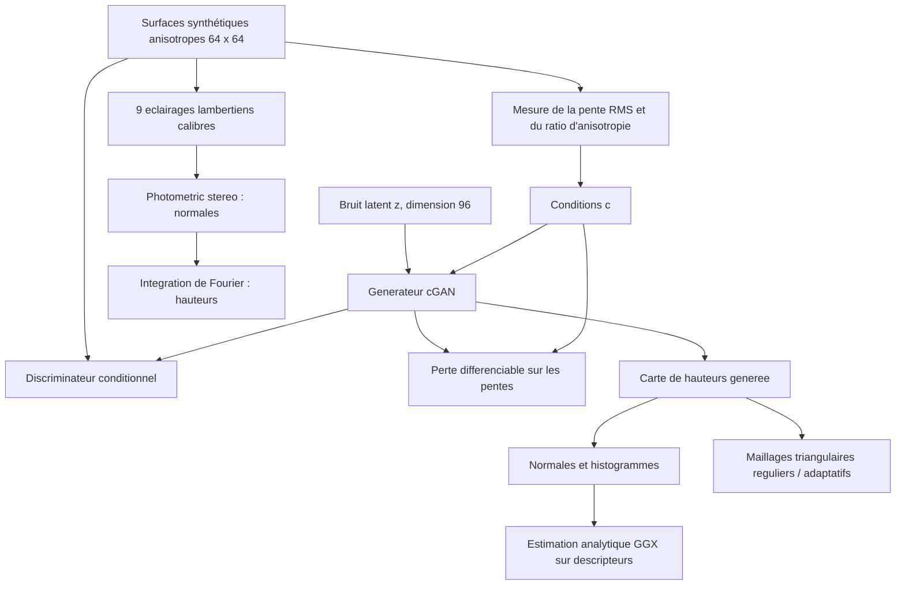

# MicroSurface-3D

[**English documentation**](README_EN.md) · [Protocole expérimental](PROTOCOL.md) · [Figures](docs/figures/) · [Résultats numériques](results/metrics/) · [Provenance des résultats](docs/RESULTS_PROVENANCE.md)


## Résumé scientifique

**Problème.** Une texture de surface microscopique peut être représentée par une carte de hauteurs $h(x,y)$. La distribution de ses pentes influence les orientations locales des normales et, sous un modèle de réflexion approprié, les caractéristiques de l'apparence lumineuse. Peut-on générer des surfaces *différentes mais contrôlables* en imposant des statistiques de pentes, puis analyser leur géométrie ?

**Approche.** MicroSurface-3D associe (i) un **GAN conditionnel** entraîné sur des champs de hauteurs synthétiques anisotropes avec une **perte différentiable de cohérence géométrique**, (ii) une analyse des normales et des maillages triangulaires, (iii) une approximation analytique de type **GGX anisotrope** pour interpréter les descripteurs, et (iv) un module **indépendant de stéréophotométrie** calibrée pour reconstruire une surface à partir de plusieurs images simulées.

**Résultat.** Après **50 époques** sur une NVIDIA RTX 2080 Ti, le générateur reproduit les conditions de pente RMS (MAE **0,00681**) et de ratio d'anisotropie (MAE **0,05713**) sur **100 conditions de validation**. Dans un autre protocole, la stéréophotométrie idéale atteint **0,163°** d'erreur angulaire moyenne des normales. Ces chiffres sont issus des fichiers de résultats fournis et **ne démontrent pas un contrôle d'une BRDF réelle**.

### Aperçu visuel


*Les références et les échantillons GAN partagent des propriétés géométriques cibles, **pas** une géométrie appariée pixel à pixel. Les couleurs représentent des hauteurs relatives (unités de grille) et des orientations de normales.*

---

## 1. Objectifs et contributions

1. **Générer** des cartes de hauteurs 64 × 64 avec des degrés de rugosité de pente et d'anisotropie paramétrables.
2. **Apprendre une distribution conditionnelle** de surfaces avec un générateur stochastique $G(z,c)$ et un discriminateur à projection conditionnelle.
3. **Imposer une cohérence géométrique** via une perte sur la pente RMS et l'anisotropie directionnelle, calculable par rétropropagation.
4. **Examiner** les normales et les distributions d'orientations, et exporter des maillages `.obj`.
5. **Comparer** triangulation régulière et raffinement adaptatif en représentation **2.5D**.
6. **Reconstruire** une surface synthétique par stéréophotométrie sous plusieurs lumières calibrées, puis intégrer ses normales.
7. **Explorer** un proxy GGX anisotrope ainsi qu'un pruning non structuré du générateur, avec des limites clairement documentées.

## 2. Architecture globale



La branche **stéréophotométrique est indépendante du GAN** dans l'implémentation actuelle : elle vérifie une méthode de reconstruction sur une autre surface synthétique, sans constituer une boucle d'entraînement ou un inverse renderer différentiable du générateur.

## 3. Génération des données et conditions de contrôle

Les données proviennent de bruit gaussien filtré spatialement, avec des largeurs de filtre différentes en $x$ et $y$, des composantes parfois multiéchelles et des conditions aux limites périodiques. Chaque carte est recentrée sur une hauteur moyenne nulle, puis mise à l'échelle pour obtenir une pente RMS échantillonnée entre **0,08 et 0,28**.

- **Entraînement :** 2 400 cartes ; **validation :** 300 cartes ; résolution **64 × 64**.
- **Seed de génération/entraînement :** `43` ; **seed de l'évaluation GAN :** `44`.
- **Unités :** espacements latéraux et hauteur exprimés en **unités de grille arbitraires**, sans étalonnage micrométrique ou modèle de fabrication.
- **Pas de données réelles** de profilométrie, ni de BRDF mesurée.

Pour une carte $h$, les dérivées spatiales périodiques donnent $p=\partial_x h$ et $q=\partial_y h$. Les deux conditions sont :

$$
 s_x=\sqrt{\mathbb{E}[p^2]},\qquad
 s_y=\sqrt{\mathbb{E}[q^2]},\qquad
 r=\sqrt{s_x^2+s_y^2},\qquad a=\frac{s_x}{s_y}.
$$

Ici $r$ est une **pente RMS**, *pas* la rugosité de hauteur $R_q$, et $a$ est un **ratio des pentes directionnelles**, *pas* une mesure physique complète de l'anisotropie optique.

## 4. Conditional GAN et contraintes géométriques

**Générateur.** Le vecteur latent $z \in \mathbb{R}^{96}$ est concaténé avec les deux conditions normalisées, puis passé dans une couche entièrement connectée et quatre couches de convolutions transposées. La sortie est une carte de hauteurs à moyenne nulle $64\times64$. Le réseau est **entraîné depuis zéro**.

**Discriminateur.** Quatre convolutions avec **spectral normalization**, activations LeakyReLU et une **projection de condition** produisent un score adversarial. L'apprentissage utilise une perte **hinge GAN**.

La perte du générateur est :

$$
\mathcal L_G=-\mathbb{E}[D(G(z,c),c)] + \lambda_{\mathrm{geom}}\mathcal L_{\mathrm{geom}},
\qquad \lambda_{\mathrm{geom}}=5.
$$

La pénalité géométrique implémentée est :

$$
\mathcal L_{\mathrm{geom}}=
\mathbb E\!\left[\frac{|r(G(z,c))-r_{\mathrm{cible}}|}{0.2}
+\left|\log a(G(z,c))-\log a_{\mathrm{cible}}\right|\right].
$$

Il s'agit d'une **contrainte sur les statistiques géométriques**. Le mot « physics » dans le code ne doit **pas** être interprété comme une simulation complète de la propagation de la lumière ou de la réponse optique des matériaux.

**Hyperparamètres observés :** 50 époques, batch 32, Adam (taux initial `2e-4`, betas `0.0,0.9`), résolution 64 × 64 et $\lambda=5$. Le checkpoint principal est `runs/microsurface/last.pt`.

## 5. Résultats expérimentaux

Les chiffres ci-dessous correspondent aux **fichiers de métriques de cette expérience**, joints dans [`results/metrics/`](results/metrics/). Les modules ont des protocoles distincts : ils ne doivent pas être interprétés comme une seule métrique de bout en bout.

### 5.1 Fidélité du conditionnement — 100 échantillons de validation

| Mesure | Valeur | Sens |
|---|---:|---|
| MAE pente RMS | **0,006806** | Écart absolu moyen entre pente cible et pente générée |
| MAE ratio d'anisotropie | **0,057130** | Écart absolu moyen entre ratios de pentes |
| MAE log-ratio d'anisotropie | **0,050758** | Écart sur logarithmes des ratios |
| Divergence JS des histogrammes d'orientation | **0,001126** | Comparaison de deux histogrammes agrégés, **proxy non étalonné de NDF** |
| Diversité sous une condition fixe (RMSE de hauteurs entre paires) | **0,436520** | Diversité empirique pour huit tirages latents ; ce n'est pas une métrique de qualité |

**Pente RMS ciblée vs obtenue :**


*Les points sont proches de la diagonale, ce qui est cohérent avec une bonne fidélité aux pentes demandées sur cet ensemble synthétique. Il reste des écarts, surtout sur certaines grandes pentes.*

**Anisotropie ciblée vs obtenue (visualisation ajoutée à partir du CSV d'évaluation) :**


*Le ratio d'anisotropie est également contrôlé, avec MAE ≈ 0,057. Les résultats restent bornés par la plage et la distribution des exemples synthétiques d'entraînement.*

**Exemples qualitatifs et cartes de normales :**


*Ce ne sont pas des paires « ground truth / reconstruction ». L'évaluation compare la conformité aux descripteurs, les distributions et la diversité, et non le PSNR entre hauteurs non appariées.*

### 5.2 Distribution des orientations — approximation de NDF


Les histogrammes représentent les composantes $(n_x,n_y)$ calculées à partir des dérivées locales, puis moyennées entre surfaces. Leur faible divergence JS indique une **proximité statistique dans ce protocole**. Ce ne sont ni une NDF microfacette normalisée et calibrée expérimentalement, ni une preuve de reproduction des propriétés optiques réelles.

### 5.3 Surface 3D exportable


Chaque champ de hauteurs est représentable comme un relief 2.5D $(x,y,h(x,y))$, visualisable en 3D, et peut être exporté en `.obj` (exemple : [`generated_surface.obj`](examples/meshes/generated_surface.obj)). **Cette représentation n'autorise pas les surplombs et n'est pas une reconstruction volumique 3D générale.**

### 5.4 Triangulation régulière et adaptative


| Méthode | Sommets | Triangles | RMSE d'interpolation (unités de hauteur) |
|---|---:|---:|---:|
| Régulière | 484 | 882 | **0,042658** |
| Adaptative | 500 | 936 | **0,041396** |

L'approche adaptative sélectionne des points supplémentaires aux endroits où l'interpolation linéaire de Delaunay produit une grande erreur. L'erreur finale est légèrement inférieure, **mais le nombre de sommets est différent** : ces chiffres ne suffisent pas à démontrer qu'elle est meilleure à budget identique. Les sorties `adaptive.obj` et `regular.obj` se trouvent dans [`examples/meshes/`](examples/meshes/).

### 5.5 Reconstruction par stéréophotométrie


Le module simule **9 directions lumineuses connues** (la figure n'en affiche que 4), avec réflectance **lambertienne**, albédo constant, bruit additif `σ = 0.002`, sans occultation ni interréflexions. Les normales sont estimées par moindres carrés, puis intégrées par Fourier en supposant des surfaces périodiques.

| Mesure | Valeur |
|---|---:|
| Erreur angulaire moyenne des normales | **0,162623°** |
| RMSE des hauteurs après alignement du niveau moyen | **0,003962** (unités de grille) |

Les résultats sont excellents **dans ce cas idéal simulé**, mais ne préjugent pas de performances avec surfaces spéculaires, ombres, calibration incertaine ou images réelles.

### 5.6 Illustration d'une réponse GGX anisotrope (*surrogate*)


Les courbes indiquent qu'un modèle **analytique GGX anisotrope paramétré heuristiquement par les moments de pente** produit des valeurs proches lorsque les descripteurs cible/générés sont proches. Attention : **les courbes ne sont pas obtenues par rendu de la microgéométrie**, et ne constituent ni des mesures BRDF, ni une validation physique de la surface générée, ni une inversion BRDF → géométrie.

### 5.7 Pruning exploratoire

Un module de **pruning non structuré** met à zéro une fraction configurable des poids (`--amount 0.2` par défaut) et mesure les changements de fidélité des descripteurs. Le fait d'annuler environ 20 % des poids **ne prouve aucun gain de vitesse GPU ou de mémoire**, en l'absence de noyaux sparse et de mesures de latence appropriées. Les métriques du pruning sont produites séparément par l'exécution du module.

## 6. Installation et reproduction

### Prérequis

Python 3.10, NumPy, SciPy, Matplotlib, PyTorch avec CUDA si GPU, et accès facultatif à SLURM. Le run rapporté a utilisé une **NVIDIA GeForce RTX 2080 Ti** avec **PyTorch 2.5.1 + CUDA 12.4**.

```bash
# Dans le dossier du projet
conda create -n microsurface python=3.10 -y
conda activate microsurface
python -m pip install -r requirements.txt
python -m pip install torch==2.5.1 --index-url https://download.pytorch.org/whl/cu124
python -m pytest -q tests
```

> Sur un nœud de connexion, `torch.cuda.is_available()` peut être `False` sans que l'installation CUDA soit défectueuse ; tester l'accès GPU **dans un job qui possède une allocation GPU**.

### Exécution sur SLURM (exemple L3i)

```bash
sinfo -h -o '%P %G'             # identifier la partition autorisée
export PARTITION=gpu-2080ti    # nom vérifié sur ce cluster, adapter ailleurs
export CONDA_ENV=microsurface
export QOS=long                 # seulement si ton compte a le droit d'utiliser ce QoS
export EPOCHS=50
export BATCH=32
bash hpc/submit_pipeline.sh

squeue -u "$USER"
# après soumission : tail -f logs/train_<JOB_ID>.out
```

Le script soumet `hpc/train.sbatch` puis `hpc/eval.sbatch` avec `afterok`, afin que l'évaluation ne démarre qu'après un entraînement terminé avec succès. Les limites configurées sont **12 h pour le train** et **2 h pour l'évaluation** ; le QoS `long` ne signifie pas que le job va automatiquement durer sept jours.

### Exécution manuelle (avec GPU déjà alloué)

```bash
python -m microsurface.data --output data/surfaces.npz --train 2400 --val 300 --seed 43
python -m microsurface.train --data data/surfaces.npz --out runs/microsurface \
  --epochs 50 --batch 32 --lambda-physics 5 --seed 43 --device cuda
python -m microsurface.evaluate --checkpoint runs/microsurface/last.pt \
  --data data/surfaces.npz --out runs/microsurface/evaluation --count 100 --device cuda
python -m microsurface.photometric --out runs/microsurface/photometric
python -m microsurface.adaptive --source runs/microsurface/evaluation/samples.npz \
  --out runs/microsurface/mesh_refinement --budget 500
python -m microsurface.prune --checkpoint runs/microsurface/last.pt \
  --data data/surfaces.npz --out runs/microsurface/pruning --amount 0.2 --device cuda
python scripts/plot_anisotropy.py --csv runs/microsurface/evaluation/sample_metrics.csv \
  --output runs/microsurface/evaluation/anisotropy_fidelity.png
```

### Arborescence principale

```text
MicroSurface3D/
├── README.md / README_EN.md
├── PROTOCOL.md                # Questions de recherche et ablations proposées
├── architecture.mmd           # Schéma de l'architecture
├── requirements.txt
├── microsurface/              # Données, GAN, entraînement, évaluation, optique, géométrie
├── hpc/                       # Scripts SLURM train / évaluation / pipeline
├── tests/                     # Tests des routines physiques
├── scripts/plot_anisotropy.py # Figure additionnelle reproductible
├── docs/figures/              # Les 8 images intégrées dans ce README
├── results/metrics/           # JSON : GAN, maillages, stéréophotométrie
├── results/samples/           # CSV des conditions et NPZ des hauteurs
└── examples/meshes/           # Fichiers OBJ démonstratifs
```

## 7. Traçabilité, limites et bonnes pratiques

- Les **métriques présentées** proviennent des fichiers JSON joints ; leurs valeurs diffèrent légèrement de celles du log SLURM `23276` communiqué précédemment. **Confirmer l'identité du run/checkpoint avant publication** (voir [provenance](docs/RESULTS_PROVENANCE.md)). Plusieurs seeds et intervalles de confiance restent nécessaires pour généraliser.
- Le split de validation contient 300 surfaces, mais **100** ont été échantillonnées pour l'évaluation GAN affichée.
- Les échantillons de référence et générés **ne sont pas appariés**. Ne pas calculer ni interpréter un PSNR de reconstruction entre eux.
- Le « proxy NDF » est un histogramme d'orientations, sans calibration microfacette ; le « surrogate GGX » dépend d'une conversion heuristique des pentes.
- Le module stéréophotométrique suit un modèle lambertien idéal, et n'entraîne pas le GAN à reproduire une BRDF.
- Le modèle n'intègre **ni matériaux réels, ni effets spectraux, ni fabrication, ni validation expérimentale**.
- **Correctif de données :** l'ancien export `sample_metrics.csv` étiquetait incorrectement l'ordre des deux colonnes centrales. L'ordre réel écrit par le programme était `target_slope,target_anis,generated_slope,generated_anis`. Les intitulés sont corrigés ici, **sans modifier les mesures**, et le code `microsurface/evaluate.py` est également corrigé.
- Des extensions pertinentes seraient un contrôle par **BRDF cible**, un rendu de microgéométrie physiquement fondé, une comparaison de maillages à **budget de sommets identique**, des ablations `lambda-physics=0` vs `5`, plusieurs seeds et des surfaces mesurées.

## 8. Positionnement scientifique

Ce prototype démontre une familiarisation pratique avec **GAN conditionnels, descripteurs de surfaces, reconstruction 2.5D et méthodes de validation optique simplifiée**. Il peut servir de point de départ à des questions d'apparence contrôlée, mais **ne résout pas à ce stade le problème inverse général BRDF → microtopographie**.

**Réutilisation :** le code et les figures sont fournis ici comme éléments d'un projet personnel. Avant de publier ce dépôt, ajouter un fichier `LICENSE` correspondant aux droits que tu souhaites accorder, et ne pas publier de données ou checkpoints de tiers sans autorisation.
