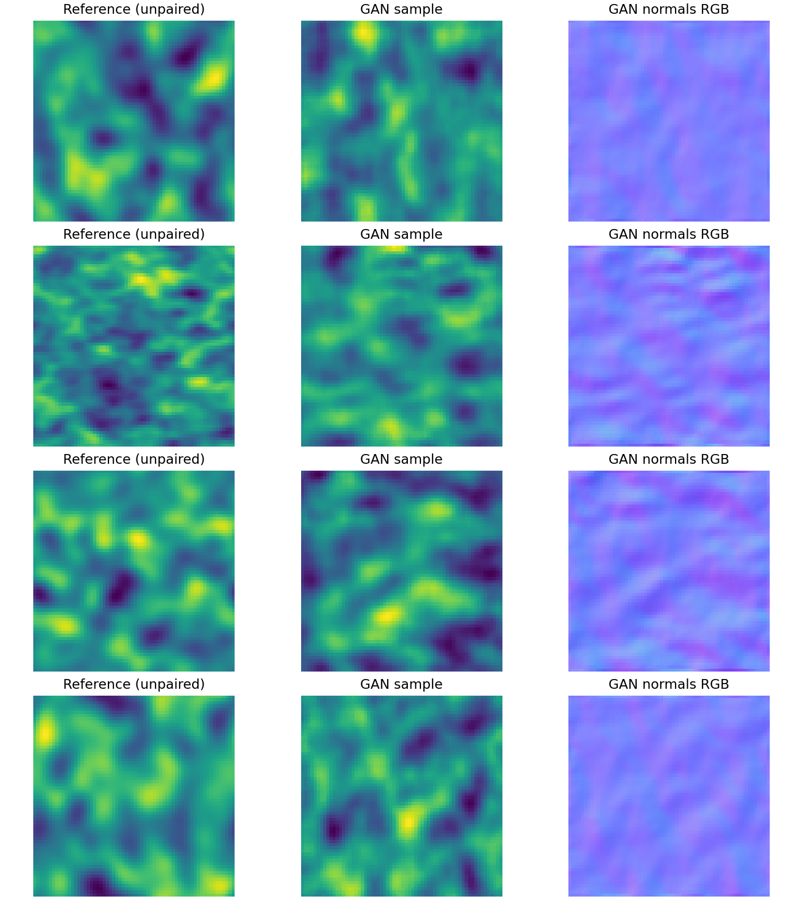
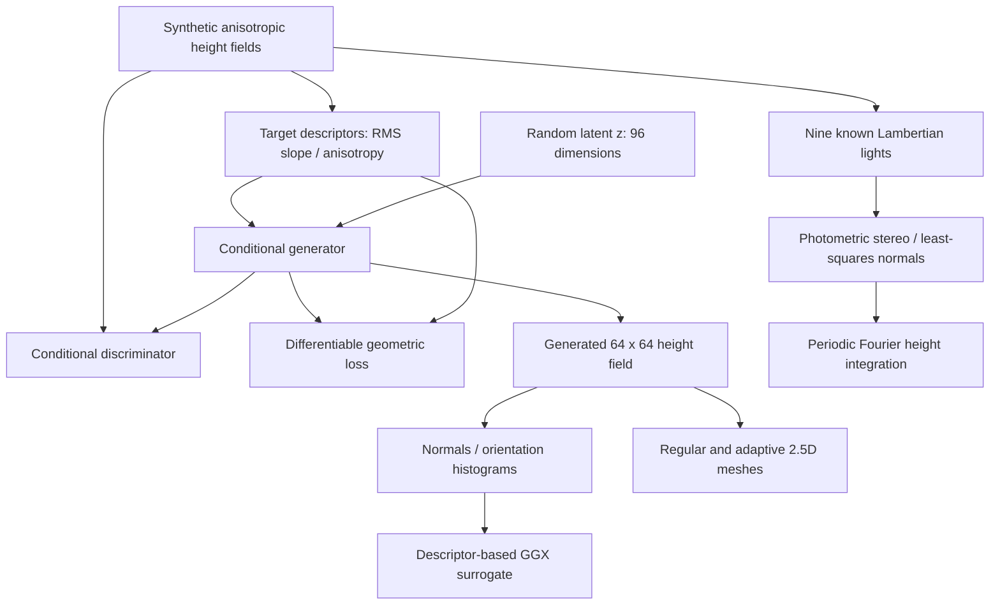
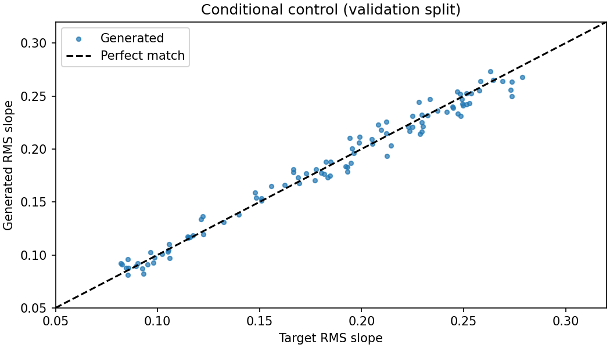
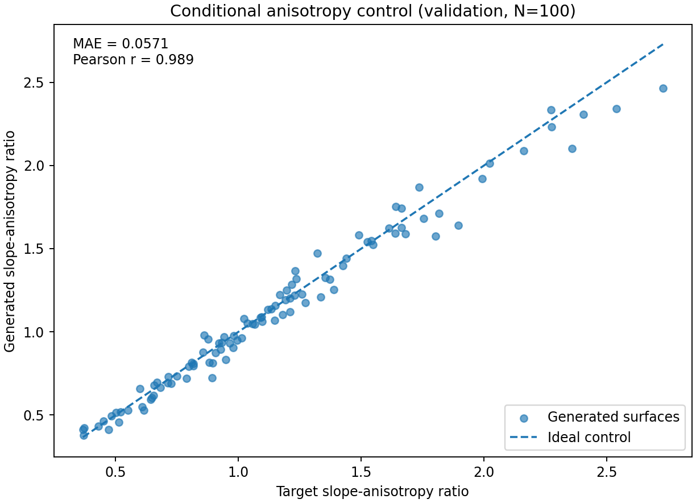
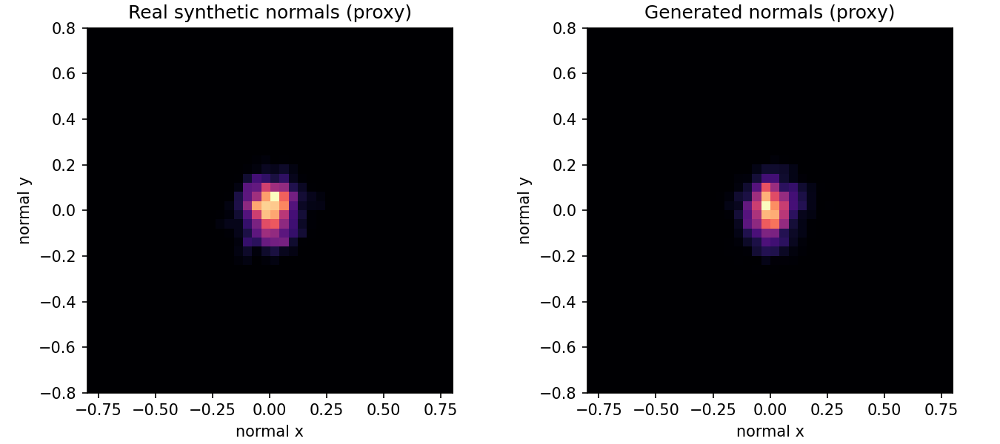
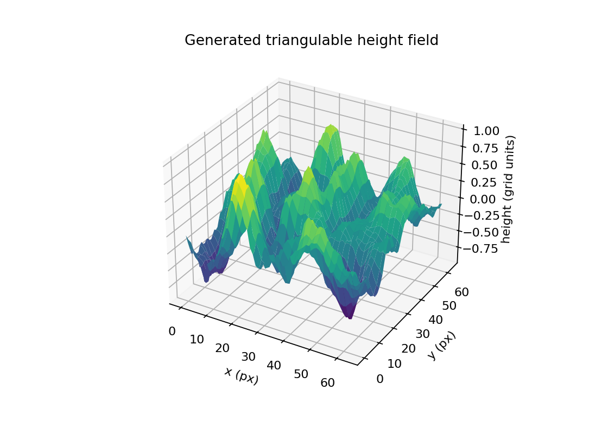
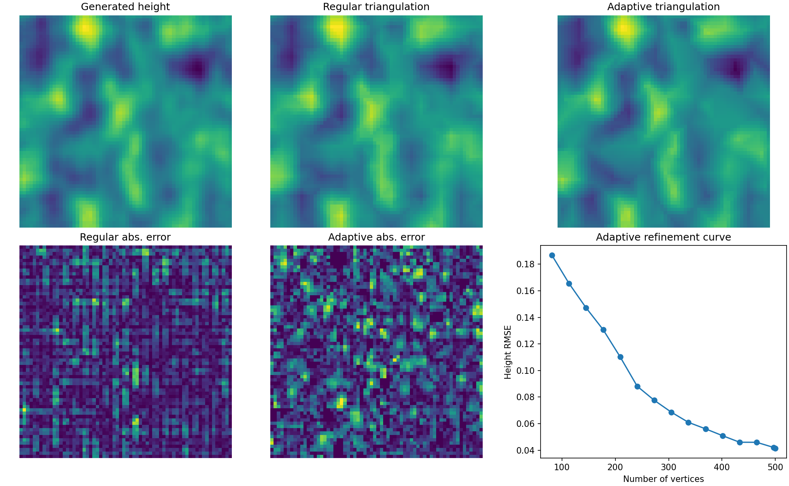
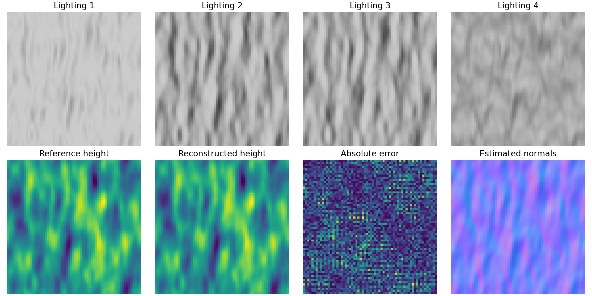
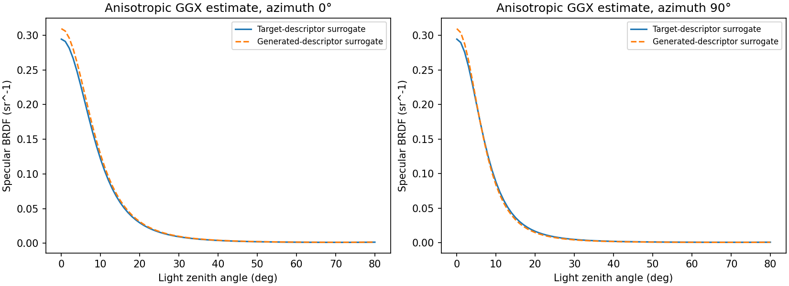

# MicroSurface-3D

**Conditional generation of synthetic microstructured height fields, photometric stereo, and geometry/optics analysis**  
*Conditional GAN · 2.5D height fields · Orientation distributions · Adaptive Delaunay meshing · Anisotropic GGX surrogate · SLURM*

[**Lire en français / French README**](README.md) · [Experimental protocol](PROTOCOL.md) · [Figures](docs/figures/) · [Numerical results](results/metrics/) · [Results provenance](docs/RESULTS_PROVENANCE.md)

> **Scope:** an independently developed, exploratory **synthetic-data research prototype**. It does not use DG-MBSR, DINOv2, or super-resolution architectures. Its motivation is related to controlled optical surface appearance and the research themes of XLIM's APPEARANCE_ON_DEMAND PhD opportunity, but it is **not official XLIM software** and **does not solve the general inverse BRDF-to-geometry problem**.

## Abstract

A microstructured surface can be described by a height field $h(x,y)$. Its local slopes determine surface normals, which influence light reflection under a suitable physical model. **MicroSurface-3D** investigates whether a **conditional generative adversarial network (cGAN)** can generate *different* height fields with controlled slope statistics, and evaluates related geometry processing and appearance proxies. The project features a differentiable geometric consistency penalty, 2.5D mesh generation and error-driven refinement, a descriptor-to-GGX analytical surrogate, and a **separate** calibrated synthetic photometric-stereo reconstruction module.

In a single 50-epoch training run on a GeForce RTX 2080 Ti, the generator achieved **0.006806 RMS slope MAE** and **0.057130 anisotropy-ratio MAE**, evaluated over **100 held-out conditions**. On an independent *idealized synthetic photometric stereo* experiment, the estimated normals reached **0.1626° mean angular error**. The numbers come from the included metrics files, not from measurements on physical samples.



*Reference and generated height maps are unpaired; only their conditioning statistics are shared. Pixelwise image reconstruction metrics do not apply.*

## 1. Research questions and main features

- **Conditional synthesis:** Can a cGAN generate height maps whose RMS slope and directional slope anisotropy match selected values?
- **Differentiable geometry constraints:** Does a geometric loss help satisfy the specified statistics while allowing different samples for the same condition?
- **Surface analysis:** What do orientation histograms and adaptive triangle meshes reveal about the generated reliefs?
- **Synthetic reconstruction:** Under calibrated Lambertian lighting, how accurately can photometric stereo reconstruct normals and a periodic height field?
- **Optical interpretation:** How does a *heuristic, descriptor-driven* anisotropic GGX response change with slope statistics?

These modules are **related but not trained end to end**. The photometric-stereo module does not feed gradients or geometry supervision into the GAN.

## 2. Pipeline



## 3. Synthetic dataset and descriptor definitions

The procedural dataset is generated from periodic Gaussian noise fields filtered with direction-dependent Gaussian kernels, occasionally combined with an additional multiscale component. Fields are zero-mean and rescaled to obtain a target **RMS slope between 0.08 and 0.28**. All spatial scales and heights are in **arbitrary grid units**: these are not calibrated micro-/nanometer profiles.

| Property | Setting |
|---|---|
| Training / validation | 2,400 / 300 synthetic height maps |
| Resolution | 64 × 64 |
| Procedural data and train seed | 43 |
| GAN evaluation seed | 44 |
| Evaluated held-out conditions | 100 |
| Height and lateral scale | Arbitrary grid units |
| Real measured surfaces / BRDF | None |

With periodic central-difference slopes $p=\partial_x h$, $q=\partial_y h$, let $s_x=\sqrt{\mathbb{E}[p^2]}$ and $s_y=\sqrt{\mathbb{E}[q^2]}$. The two condition variables are:

$$
r=\sqrt{s_x^2+s_y^2}, \qquad a=\frac{s_x}{s_y}.
$$

Here, $r$ measures **RMS slope**, *not* RMS **height roughness** $R_q$; $a$ is a **directional slope ratio**, not a complete optical anisotropy descriptor.

## 4. GAN architecture and objective

**Generator:** input $z\in\mathbb{R}^{96}$ plus normalized condition vector $c=[r,a]$, followed by a dense projection and four transposed-convolution layers, yielding a zero-centered 64 × 64 height map.  
**Discriminator:** four spectrally normalized convolution layers with LeakyReLU and a condition-projection term.  
**Objective:** a hinge adversarial objective with geometry-consistency loss:

$$
\mathcal{L}_G=-\mathbb{E}[D(G(z,c),c)]+\lambda_{\rm geom}\mathcal{L}_{\rm geom},
\quad\lambda_{\rm geom}=5,
$$

$$
\mathcal{L}_{\rm geom}=\mathbb{E}\!\left[
\frac{|r(G(z,c))-r_{\rm target}|}{0.2}
+|\log a(G(z,c))-\log a_{\rm target}|
\right].
$$

The label “physics loss” in the implementation refers to **differentiable geometric consistency only**, not to ray tracing, Maxwell equations, or an experimentally validated forward optical model.

**Training:** 50 epochs, batch size 32, Adam ($2\times10^{-4}$, $\beta_1=0,\beta_2=0.9$), geometric-loss multiplier 5, PyTorch 2.5.1 + CUDA 12.4 and RTX 2080 Ti.

## 5. Quantitative evaluation and visual results

The metrics were generated by distinct tasks; **do not combine them into an end-to-end inverse optics accuracy claim**. Raw JSON metrics are in [`results/metrics/`](results/metrics/), and the 100 per-condition samples are in [`results/samples/`](results/samples/).

### 5.1 Condition fidelity (100 validation conditions)

| Metric | Result | What it measures |
|---|---:|---|
| RMS slope MAE | **0.006806** | Mean absolute target/generated slope discrepancy |
| Anisotropy ratio MAE | **0.057130** | Mean absolute difference between slope ratios |
| Log anisotropy MAE | **0.050758** | Mean absolute difference of log ratios |
| Aggregated normal-orientation histogram JS divergence | **0.001126** | Histogram agreement, **not a calibrated NDF** |
| Fixed-condition pairwise height RMSE | **0.436520** | Diversity of 8 independent latent draws; not a quality score |

**RMS slope control**



**Anisotropy ratio control (new reproducible figure)**



**Qualitative height maps and calculated RGB normals**


The plotted surfaces exhibit plausible spatial variations for this synthetic source. This visual observation alone does **not** establish faithful matching of real microstructure statistics or physical appearance.

### 5.2 Normal orientation proxy



These histograms bin $(n_x,n_y)$ calculated from each height map. They are useful **normal-orientation statistics**, but not a measured, physically calibrated microfacet normal distribution function (NDF).

### 5.3 2.5D surface geometry



Output height maps can be triangulated and exported as Wavefront `.obj`, for instance [`generated_surface.obj`](examples/meshes/generated_surface.obj). They represent **2.5D single-valued height fields** rather than general 3D objects with overhangs.

### 5.4 Adaptive vs regular height-field triangulation



| Mesh | Vertices | Triangles | Height-interpolation RMSE |
|---|---:|---:|---:|
| Regular grid | 484 | 882 | **0.042658** |
| Error-driven adaptive Delaunay | 500 | 936 | **0.041396** |

Adaptive vertex insertion prioritizes locations with higher piecewise-linear interpolation error. **The final vertex counts differ**, so the small observed error difference is **not** a fair fixed-budget superiority demonstration. Example [`adaptive.obj`](examples/meshes/adaptive.obj) and [`regular.obj`](examples/meshes/regular.obj) are included.

### 5.5 Idealized photometric stereo



A distinct surface is lit from **nine known directions** (only four views shown above), rendered with **constant-albedo Lambertian reflection**, additive Gaussian noise of standard deviation `0.002`, and no shadows, interreflections or non-Lambertian effects. Least-squares fitting estimates normals, followed by **periodic Fourier height integration**.

| Metric | Value |
|---|---:|
| Normal mean angular error | **0.162623°** |
| Mean-aligned height RMSE | **0.003962 grid units** |

This is a **synthetic, calibrated, favorable setup**; results should not be extrapolated to uncalibrated or real specular surfaces.

### 5.6 Anisotropic GGX *surrogate*



An anisotropic GGX formula is evaluated with parameters obtained **heuristically from the height-field slope statistics**. These curves are **not rendered from the actual 3D microgeometry**, and are neither measured BRDF curves nor proof of accurate inverse optical design. They provide a visualization of how *descriptor matching* affects one assumed analytic BRDF model.

### 5.7 Exploratory unstructured pruning

An optional L1 magnitude pruning stage zeros a configurable share of selected generator weights (default: `0.2`) and compares condition errors. **20% zero-valued parameters do not establish 20% faster GPU inference or a smaller checkpoint** without sparse operations and runtime measurements.

## 6. Installation and reproducibility

```bash
conda create -n microsurface python=3.10 -y
conda activate microsurface
python -m pip install -r requirements.txt
python -m pip install torch==2.5.1 --index-url https://download.pytorch.org/whl/cu124
python -m pytest -q tests
```

On a GPU-free login node, `torch.cuda.is_available()` may be false even if PyTorch's CUDA wheel is installed. Verify CUDA **inside the SLURM GPU allocation**.

**L3i cluster example: RTX 2080 Ti, `gpu-2080ti`, QoS `long` (subject to account permissions)**

```bash
sinfo -h -o '%P %G'
export PARTITION=gpu-2080ti
export CONDA_ENV=microsurface
export QOS=long
export EPOCHS=50
export BATCH=32
bash hpc/submit_pipeline.sh
squeue -u "$USER"
```

The submit script launches `train.sbatch` and then `eval.sbatch` with an `afterok` dependency. Wall-time requests remain **12 hours** (training) and **2 hours** (evaluation), independent of the QoS maximum.

**Manually reproduce all modules (from a GPU allocation):**

```bash
python -m microsurface.data --output data/surfaces.npz --train 2400 --val 300 --seed 43
python -m microsurface.train --data data/surfaces.npz --out runs/microsurface \
  --epochs 50 --batch 32 --lambda-physics 5 --seed 43 --device cuda
python -m microsurface.evaluate --checkpoint runs/microsurface/last.pt \
  --data data/surfaces.npz --out runs/microsurface/evaluation --count 100 --device cuda
python -m microsurface.photometric --out runs/microsurface/photometric
python -m microsurface.adaptive --source runs/microsurface/evaluation/samples.npz \
  --out runs/microsurface/mesh_refinement --budget 500
python -m microsurface.prune --checkpoint runs/microsurface/last.pt \
  --data data/surfaces.npz --out runs/microsurface/pruning --amount 0.2 --device cuda
python scripts/plot_anisotropy.py --csv runs/microsurface/evaluation/sample_metrics.csv \
  --output runs/microsurface/evaluation/anisotropy_fidelity.png
```

**Project layout:**

```text
MicroSurface3D/
├── README.md                  # Complete French README
├── README_EN.md               # This English README
├── PROTOCOL.md                # Experimental questions and planned ablations
├── architecture.mmd           # Editable Mermaid flowchart
├── microsurface/              # Data, cGAN, geometry, optics, evaluation modules
├── hpc/                       # Training and evaluation SLURM scripts
├── scripts/plot_anisotropy.py # CSV-based anisotropy figure
├── tests/
├── docs/figures/             # Eight embedded figures
├── results/metrics/          # Validated JSON reports
├── results/samples/          # Correctly labeled CSV and NPZ results
└── examples/meshes/          # Example OBJ meshes
```

## 7. Reproducibility notes and limitations

- **Confirm run/checkpoint provenance before publishing:** the attached JSON values differ slightly from the earlier SLURM job `23276` evaluation log. See [results provenance](docs/RESULTS_PROVENANCE.md). A **single seed/run** does not establish confidence intervals.
- The validation data contains 300 surfaces, but the listed GAN metrics use the first **100** validation conditions.
- No one-to-one correspondence exists between generated and reference height maps. Pixel-aligned PSNR or reconstruction RMSE would be misleading here.
- Normal orientation histograms are **proxies**, GGX parameters are **heuristic**, and simulated Lambertian photometric stereo is **not** a real optical metrology experiment.
- No fabrication constraints, wavelength-specific materials, measured BRDFs or real samples are evaluated.
- The mesh algorithm is restricted to **single-valued 2.5D surfaces**; its fixed-budget comparison needs improvement.
- **CSV fix:** An earlier `sample_metrics.csv` export mislabeled the two middle columns, while recording correct values in the order `target_slope,target_anis,generated_slope,generated_anis`. This repository corrects both the example CSV header **and** the corresponding code. Numerical values are untouched.

**Potential next studies:** multiple seeds and confidence intervals, loss-weight ablations (`--lambda-physics 0` vs `5`), a condition-fixed diversity distribution, fair mesh budget comparisons, microgeometry-based physically grounded rendering, true BRDF-conditioned synthesis and, ultimately, validation on measured surfaces.

## 8. Research relevance

MicroSurface-3D demonstrates hands-on experience in **conditional image-like geometric generation, slope/normal analysis, photometric stereo, 2.5D mesh processing and carefully qualified optical surrogates**. It is a preliminary methodological exploration rather than a validated inverse design tool for real optical microstructures.

**Licensing:** no license is chosen by this README. Before making the repository public, add a `LICENSE` file specifying the intended terms and confirm ownership of all included content.
